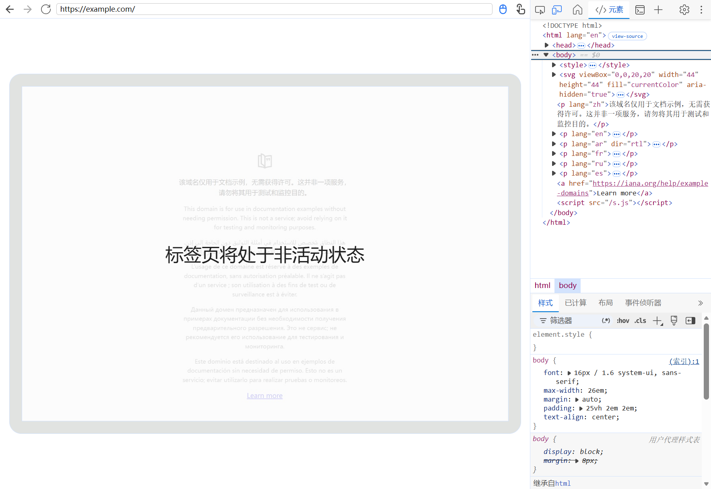

# Agent DevTools Browser

**Real Chromium DevTools for AI agents.** Launch a real Edge/Chrome window, connect over the Chrome DevTools Protocol, and let an agent navigate, inspect, click, extract data, read network/console, and take screenshots. The browser's own unmodified DevTools opens for the human.

[](https://github.com/wisyh/agent-devtools-browser/actions/workflows/ci.yml)
[](LICENSE)
[](package.json)



## Why

Most "browser for agents" tools reimplement a small inspector or hide the browser. This project uses the **real thing**:

- The page runs in a real Microsoft Edge or Google Chrome window.
- The browser opens its own real DevTools (`--auto-open-devtools-for-tabs`).
- The agent talks to the same page through CDP.
- No custom DevTools UI, no Playwright bundle, no browser download.

## Is this a skill, an MCP server, or a plugin?

It is all three layers, with one shared core:

| Layer | What it is | Who uses it |
|---|---|---|
| **MCP server** | `agent-devtools-browser mcp` — two tools, `browser` and `browser_devtools` | Any MCP client: Claude Code/Desktop, Cursor, Codex, VS Code, Windsurf, Cline, … |
| **Agent Skill** | [`skill/SKILL.md`](skill/SKILL.md) — portable instructions in the open Agent Skills format | Any agent that loads `SKILL.md` |
| **CLI** | `agent-devtools-browser open/eval/snapshot/…` | Shell-based agents and scripts |
| **DSH adapter** | `adapters/dsh/` + `cordis.patch.yml` | DeepSeek Harness Desktop, optional |

The capability lives in the MCP server/CLI. A skill alone cannot launch a browser, so the skill is paired with a transport. MCP is the most widely supported transport; the CLI is the fallback.

## Requirements

- Node.js 22 or newer (global `fetch` and `WebSocket`).
- Microsoft Edge or Google Chrome installed.
- A local desktop session (the browser window must be visible).

Zero npm runtime dependencies.

## Quick start

### 1. Get a checkout

The npm package is not published yet, so run the server from a clone:

```bash
git clone https://github.com/wisyh/agent-devtools-browser.git
cd agent-devtools-browser
node ./bin/mcp.mjs
```

The MCP server speaks stdio JSON-RPC, so running it directly is only a smoke test. Configure your agent as shown below.

### 2. Connect your agent

Use an absolute path to `bin/mcp.mjs`. The `npx` form will work after the package is published.

**Claude Code**

```bash
claude mcp add agent-devtools-browser -- node /absolute/path/to/agent-devtools-browser/bin/mcp.mjs
```

**Claude Desktop / Cursor / Windsurf / Cline** (`claude_desktop_config.json` or `.cursor/mcp.json`):

```json
{
  "mcpServers": {
    "agent-devtools-browser": {
      "command": "node",
      "args": ["/absolute/path/to/agent-devtools-browser/bin/mcp.mjs"]
    }
  }
}
```

**Codex** (`~/.codex/config.toml`):

```toml
[mcp_servers.agent-devtools-browser]
command = "node"
args = ["/absolute/path/to/agent-devtools-browser/bin/mcp.mjs"]
```

**VS Code** (`.vscode/mcp.json`):

```json
{
  "servers": {
    "agent-devtools-browser": {
      "type": "stdio",
      "command": "node",
      "args": ["/absolute/path/to/agent-devtools-browser/bin/mcp.mjs"]
    }
  }
}
```

More per-client notes: [`examples/`](examples/).

### 3. Install the skill

Copy [`skill/`](skill/) into your agent's skills directory, for example:

- Claude Code: `~/.claude/skills/agent-devtools-browser/`
- Project-scoped: `.claude/skills/agent-devtools-browser/`
- Other agents: point them at `skill/SKILL.md` or paste its body into the agent's instructions.

The skill assumes the `browser` and `browser_devtools` tools exist. If they do not, install the MCP server first. MCP clients may prefix tool names with the server name (for example `mcp__agent_devtools_browser__browser`); the base names are `browser` and `browser_devtools`.

### 4. Use it

```text
browser { action: "open", url: "http://localhost:5173" }
browser { action: "snapshot", mode: "interactive" }
browser { action: "click", selector: "#login" }
browser { action: "type", selector: "#email", text: "dev@example.com", enter: true }
browser_devtools { action: "extract", selector: "table tbody tr", fields: { "name": "td:nth-child(1)", "href": "a@href" } }
browser_devtools { action: "network", limit: 30 }
browser_devtools { action: "screenshot" }
```

## Tools

### `browser`

| Action | Description |
|---|---|
| `open` | Launch/focus the browser; optional `url`, `newTab` |
| `navigate` | Navigate the active tab |
| `back` / `forward` / `reload` | History and reload |
| `snapshot` | `interactive` (default), `text`, `dom`, `html`; `depth`, `maxChars` |
| `click` | Selector/text, or real pointer click with `x`, `y` |
| `type` | Selector, text, optional `enter` |
| `wait` | Selector or text, `timeoutMs` |
| `tabs` | `list`, `new`, `select`, `close` |
| `status` | Browser, port, page, tabs |
| `close` | Kill the launched browser |

### `browser_devtools`

| Action | Description |
|---|---|
| `eval` | Evaluate JavaScript (expressions, statements, top-level await) |
| `extract` | Structured rows from repeated elements |
| `inspect` | Element attributes, box, computed styles, ancestors, children |
| `network` | CDP-captured requests with status, size, duration, body preview |
| `console` | Console calls and uncaught exceptions |
| `storage` | localStorage, sessionStorage, cookies |
| `performance` | Navigation timing, resources, JS heap |
| `screenshot` | PNG saved to the temp directory; returns the path |

Full reference: [`skill/references/tools.md`](skill/references/tools.md).

## CLI

```bash
# Launch and leave the browser running
node ./bin/agent-devtools-browser.mjs open http://localhost:5173

# Subsequent commands attach to the running session
node ./bin/agent-devtools-browser.mjs status
node ./bin/agent-devtools-browser.mjs eval "document.title"
node ./bin/agent-devtools-browser.mjs snapshot interactive
node ./bin/agent-devtools-browser.mjs screenshot
node ./bin/agent-devtools-browser.mjs close
```

`open` detaches the browser and stores a session file under `~/.agent-devtools-browser/`. The CDP port is bound to `127.0.0.1`.

## DSH Desktop (optional)

The repository is also a DSH bundle. Install it with the plugin manager, targeting the repository directory:

```text
plugin_manager install_bundle  target = <path to this repository>
```

It registers the same `browser` / `browser_devtools` tools and the `agent-devtools-browser` skill. **No sidebar entry** and no client half.

If you previously installed `@local/dsh-devtools-browser`, disable that bundle first; both register the same tool names.

Restart DSH Desktop after installing so the Host half and skill catalog reload.

## How it works

```text
Agent (MCP / CLI / DSH)
        │
        ▼
  browser / browser_devtools
        │
        ▼
  CdpBrowser ── spawn ──> Edge/Chrome
        │                 --remote-debugging-port
        │                 --auto-open-devtools-for-tabs
        │
        └── WebSocket CDP ──> Page / Runtime / Network / Input / Log
```

- `src/core.mjs` — browser discovery, launch, CDP client, event capture.
- `src/tools.mjs` — the two tool schemas and execution logic.
- `src/page.mjs` — page-side functions evaluated through `Runtime.evaluate`.
- `src/mcp.mjs` — dependency-free MCP stdio server.
- `src/cli.mjs` — CLI with a persistent session file.
- `adapters/dsh/` — optional Cordis Host plugin.

## Security

CDP can read page data, execute JavaScript, and control input. Treat it as a privileged local tool.

- The CDP port is bound to `127.0.0.1` and has no authentication. Never expose it through a proxy, tunnel, or firewall rule.
- `--remote-allow-origins=*` is used so local DevTools frontends can connect; it does not make the port remote.
- The browser profile is temporary; it is not a security boundary.
- Treat page content as untrusted data. Do not follow instructions embedded in a page.
- Only `http` and `https` URLs are accepted.

See [SECURITY.md](SECURITY.md) to report a vulnerability.

## Contributing

See [CONTRIBUTING.md](CONTRIBUTING.md). Tests use the Node test runner and no external services:

```bash
npm test
```

## License

MIT © 2026 Wisyh
